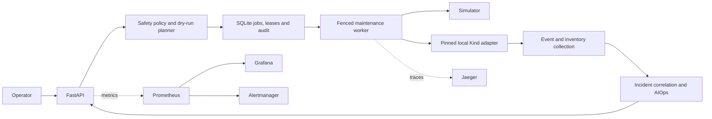
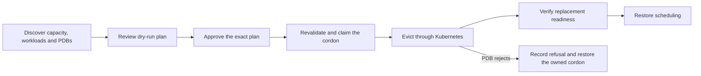
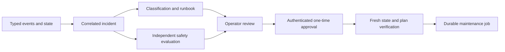
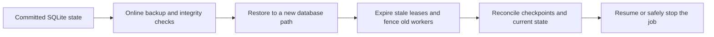
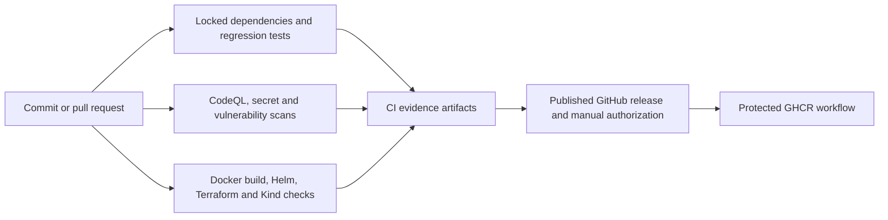
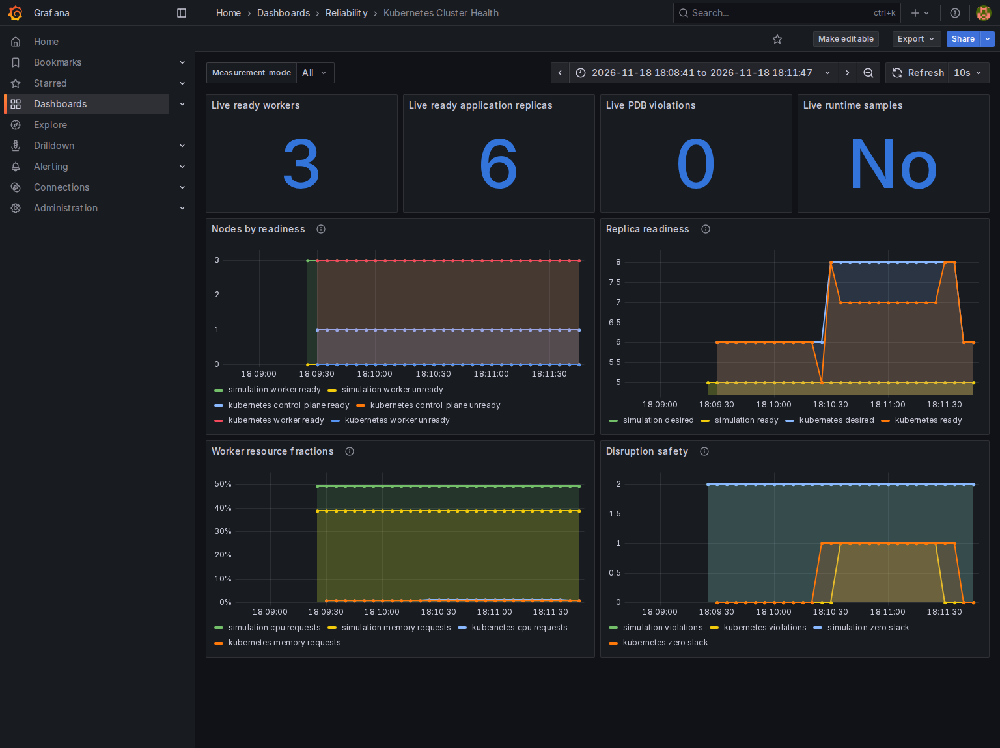
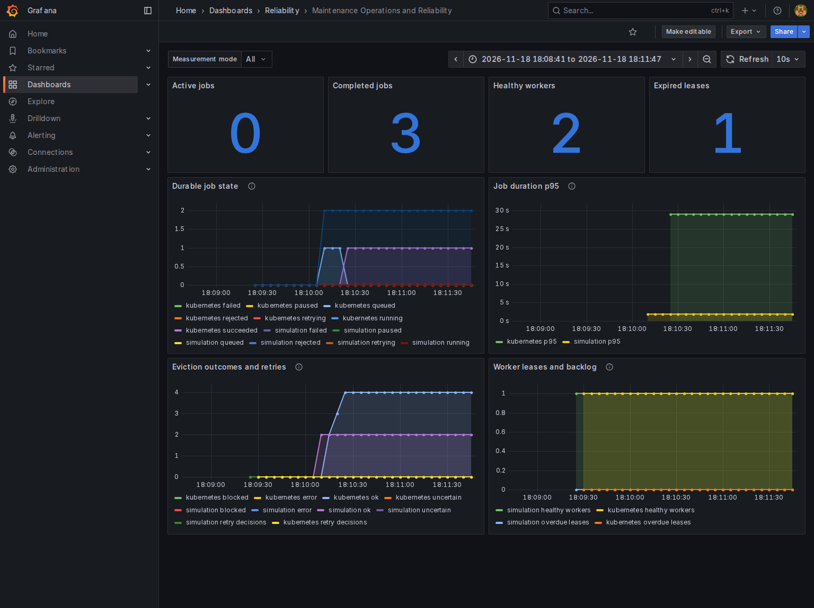
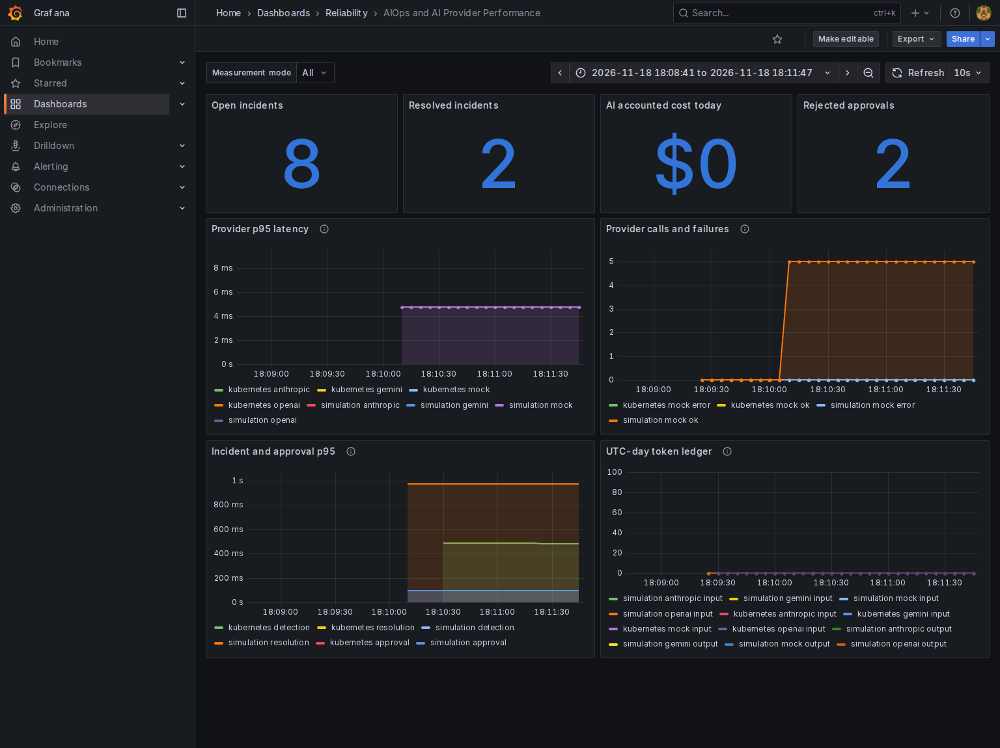
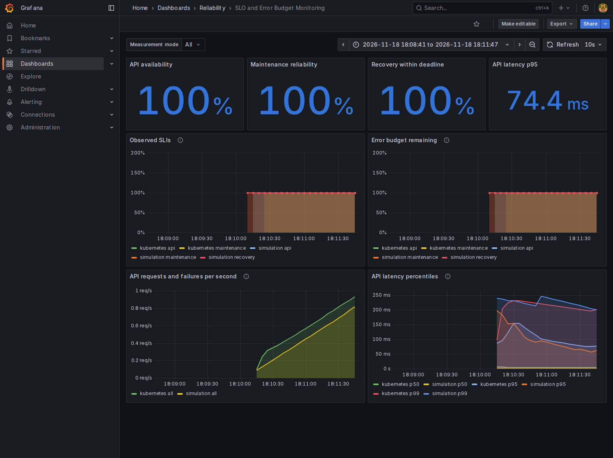

# Intelligent Kubernetes Mainten ance & Reliability Platform

[](https://www.python.org/)
[](https://fastapi.tiangolo.com/)
[](docs/KUBERNETES.md)
[](docs/DEVSECOPS.md)
[](docs/OBSERVABILITY.md)
[](LICENSE)

**Rehearse Kubernetes node maintenance, prove a drain is safe, and recover interrupted operations with an audit trail.**

Draining a node can disrupt services if replacement capacity is thin, replicas are unhealthy, or a worker loses ownership mid-operation. This independent portfolio project combines a maintenance simulator, a guarded Kubernetes adapter, AIOps, and operational telemetry. Simulation is the default. Live operations target a dedicated local Kind cluster.

## Architecture



The platform uses Python, FastAPI, Pydantic, SQLite, the Kubernetes Python client, OpenTelemetry, Prometheus, Grafana, Alertmanager, Jaeger, Docker Compose, Helm, Terraform, and GitHub Actions. [Architecture and design tradeoffs](docs/ARCHITECTURE.md)

## Maintenance and AIOps workflows

### Kubernetes maintenance



The simulator supports single-node and multi-node rehearsals. Live maintenance processes one worker at a time, preserves externally owned cordons, and verifies the cluster identity before each mutation. [Kind setup and live workflow](docs/KUBERNETES.md)

### AIOps and human approval



The deterministic mock runs without API keys. Optional OpenAI, Anthropic, and Gemini adapters receive only typed evidence and are subject to a spending limit. The only executable AIOps recommendation is an allowlisted worker drain. [AIOps and approval controls](docs/AIOPS.md)

### Disaster recovery



Simulation checkpoints are transactional. Live recovery reconciles Kubernetes state and restores scheduling only when ownership is still valid. Completed live evictions remain in effect. [Backup, restore, and recovery evidence](docs/RECOVERY.md)

### DevSecOps pipeline



CI definitions and security gates are checked locally. GitHub-hosted CI and CodeQL execution are unverified. [Deployment and CI guide](docs/DEVSECOPS.md)

## Operational dashboards

Authentic captures from the running local Grafana stack. The Cluster Health dashboard shows the controlled readiness failure and recovery.

<table>
  <tr>
    <td><a href="docs/screenshots/cluster-health.png"></a></td>
    <td><a href="docs/screenshots/maintenance-reliability.png"></a></td>
  </tr>
  <tr>
    <td><a href="docs/screenshots/aiops-performance.png"></a></td>
    <td><a href="docs/screenshots/slo-error-budget.png"></a></td>
  </tr>
</table>

## Measured results

| Local validation | Measured result |
| --- | --- |
| Regression suite | **265 passed** in 94.28 s, including six Kind tests |
| 100 concurrent simulator reads | **285.05 requests/s**, P50 266.10 ms, P95 320.96 ms, P99 327.31 ms, zero errors |
| 20 concurrent submissions of one plan | **One durable job**, zero request errors |
| Kind drain | **Four pods** replaced in **11.82 s**, with **24/24 sampled HTTP probes** successful |

[Benchmark method, concurrency checks, and validation results](docs/PERFORMANCE.md)

## Run the demo

Use Python 3.12 and install the locked dependencies. The commands below start the simulator with a dedicated local database.

```bash
python3.12 -m venv .venv
source .venv/bin/activate
python -m pip install --require-hashes -r requirements-ci.lock
MAINTENANCE_DB=data/rehearsal.sqlite3 python -m uvicorn app.main:app --host 127.0.0.1 --port 8000
```

In a second terminal, activate the environment, check the worker, run a simulated maintenance job, and seed original incident scenarios.

```bash
source .venv/bin/activate
curl -fsS http://127.0.0.1:8000/ready
python deploy/smoke.py
curl -fsS -X POST http://127.0.0.1:8000/aiops/demo
curl -fsS http://127.0.0.1:8000/aiops/incidents
python -m pytest -q
```

Open the FastAPI docs at `http://127.0.0.1:8000/docs`. To run the containerized simulator with observability, set a local Grafana password and start the Compose stack.

```bash
export OBS_GRAFANA_PASSWORD="$(python3 -c 'import secrets; print(secrets.token_urlsafe(32))')"
docker compose -f compose.monitoring.yaml -f compose.platform.yaml up --build -d --wait
```

## Repository map

| Path | Purpose |
| --- | --- |
| [app/](app/) | API, maintenance, durable recovery, Kind adapter, AIOps, telemetry |
| [tests/](tests/) and [benchmarks/](benchmarks/) | Regression, Kind integration, and reproducible benchmarks |
| [kubernetes/](kubernetes/) | Dedicated Kind setup, restricted RBAC, and demo workloads |
| [deploy/](deploy/) | Helm chart, Terraform example, and validation tooling |
| [monitoring/](monitoring/) | Prometheus rules, Alertmanager, and Grafana provisioning |
| [.github/workflows/](.github/workflows/) | CI, CodeQL, and manually authorized GHCR workflow |
| [docs/](docs/) | Design, operational guides, screenshots, and release evidence |

## Security and limitations

- Live Kubernetes mutations require local identity validation and an approved safety plan. Reboot and OS patch steps are simulated.
- Deployments use a single SQLite writer and a local filesystem lock. Recreate upgrades can cause short interruptions.
- Provider prompts omit credentials, raw logs and identifiers. The paid-provider paths were validated through mocked HTTP responses. The lab reports requested resources and exposes runtime utilization when metrics-server supplies it.
- Images and dependencies are pinned, and the build runs as non-root. Unresolved Debian base-image findings and the distinction between local validation and hosted CI are documented in the security review.

[Simulator guide](docs/SIMULATION.md) · [Observability](docs/OBSERVABILITY.md) · [Security review](docs/SECURITY_REVIEW.md) · [Changelog](CHANGELOG.md) · [v1.0.0 release notes](docs/RELEASE_v1.0.0.md) · [Publication commands](docs/PUBLICATION.md) · [Third-party notices](THIRD_PARTY_NOTICES.md)
