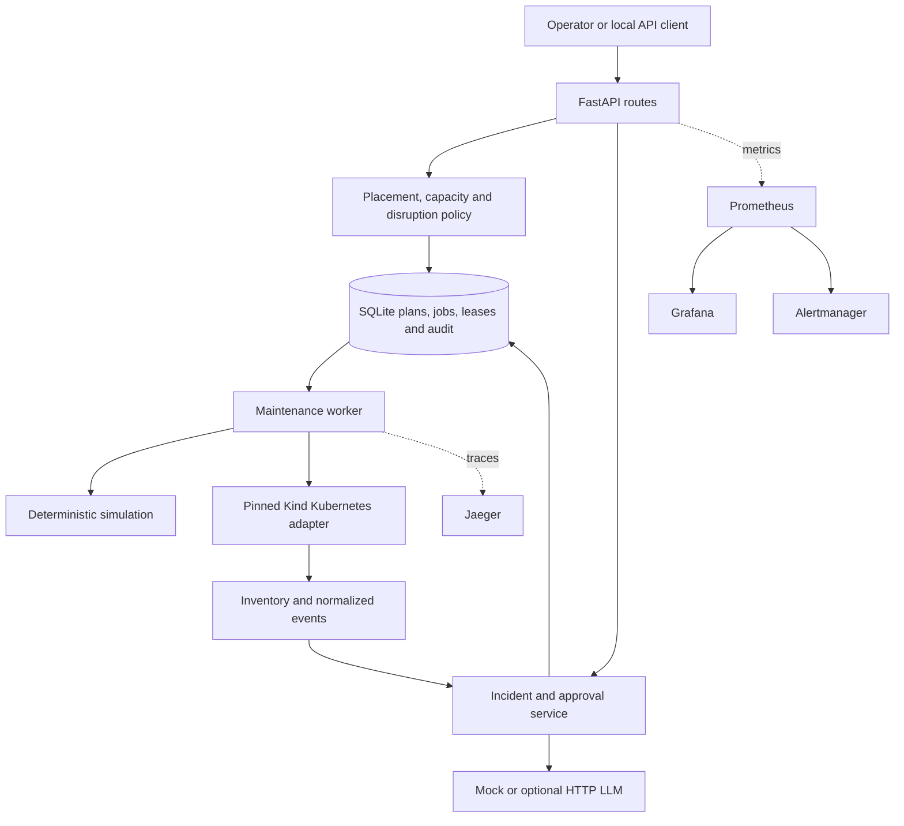
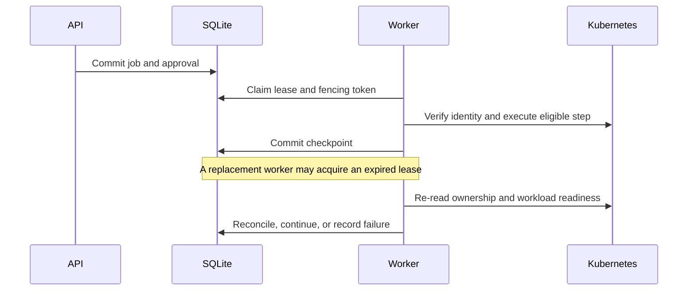

# Architecture

The platform makes disruption risk visible before a maintenance job starts. A simulator supports inexpensive rehearsal. The live adapter exercises actual Kubernetes APIs in a four-node Kind lab.

## Maintenance contracts

| Component | Responsibility |
| --- | --- |
| Planner | Checks destination capacity, protected workloads and disruption headroom. The batch scheduler searches bounded waves and exposes rejected placements. |
| Durable job service | Stores admission and checkpoints, deduplicates by plan, owns one operation at a time and fences expired workers. |
| Simulation engine | Advances a virtual clock and commits a successful snapshot with its audit. A simulator failure preserves the prior committed state. |
| Live engine | Validates the pinned cluster, uses Kubernetes resource versions and ownership annotations, submits graceful evictions through the Eviction API, and waits for Ready replacements. |
| Recovery | Restores verified online backups to a new path, expires copied leases and resumes work from durable state after reconciliation. |

The live engine re-reads Kubernetes state after errors. It can restore an owned cordon and stop safely after an eviction rejection. A completed eviction remains an external side effect. Live reboot and OS patch actions are simulated.

## Evidence and authority

The collector projects events and status into typed signals. Correlation links pod symptoms to workloads, detects repeat events, and records incident revisions. The classifier produces a structured brief with evidence references and known runbooks. The safety evaluator runs separately, derives actionable targets only from trusted evidence, and recomputes the plan at approval time.

An operator identity comes from the configured token mapping. Approval consumes a short-lived nonce, binds to the reviewed recommendation and current scope, and submits only the allowlisted worker-drain action. Provider output carries no execution authority.

## Failure and recovery

For an explicit backup recovery, the CLI performs an online SQLite snapshot, validates integrity, and atomically publishes to a new database path. The restored copy clears stale lease ownership. The operator restarts the application against that database and evaluates any state written after the backup timestamp. [Recovery workflow](RECOVERY.md)

## Deployment and observability

Compose provisions the simulator and monitoring services on loopback. Helm runs the simulator and its worker in one restricted pod with a persistent claim, readiness probes and a filesystem lock. Terraform owns the isolated namespace and its supporting identity. Helm owns the application resources. The existing live adapter operates from the host with separately pinned credentials.

Metrics identify simulation and Kubernetes measurements with bounded labels. SQLite backs durable job and incident counters. The API and adapters record request latencies and emit traces. Prometheus evaluates SLO rules over observed events, and Alertmanager groups firing and resolved notifications. [Observability and deployment](OBSERVABILITY.md) · [DevSecOps](DEVSECOPS.md)
